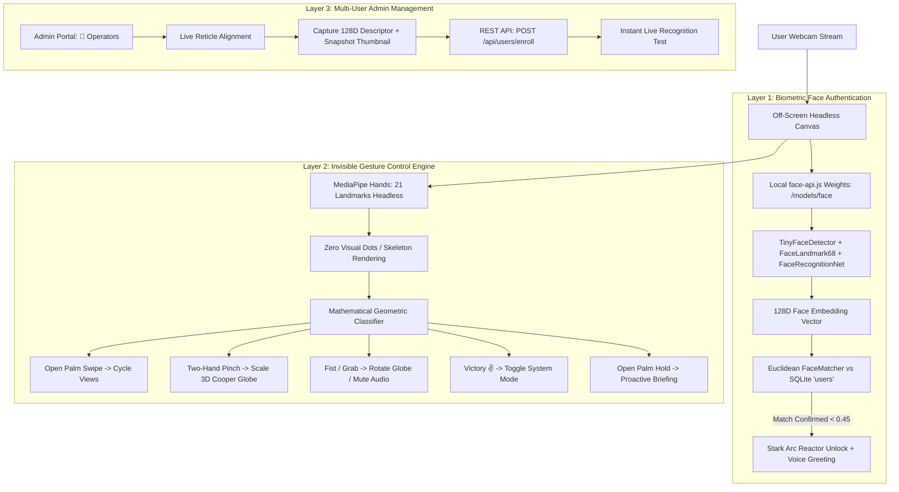

# 🚀 Tony Stark Invisible Gestures & Biometric Face Authentication — Walkthrough

We have successfully integrated a **Tony Stark / Jarvis-level invisible gesture control engine** and a **multi-user facial recognition biometric security system** into **Agentic OS (Cooper)**.

---

## 🏗️ Architecture & Topology



---

## 🌟 Key Capabilities Delivered

### 1. 🖐️ Invisible Hand Gesture Engine (`gestureEngine.js`)
- **Strict Invisibility**: Processes hand tracking completely in memory on an offscreen video element. **No dots, lines, or skeleton landmarks are rendered over hands or on the UI**.
- **Gestures Supported**:
  - **Open Palm Swipe (Left / Right)**: Smoothly cycles across OS views (Dashboard <-> Content Studio <-> Sources <-> Settings).
  - **Two-Hand Pinch**: Dynamically scales the 3D Cooper globe or zooms the HUD.
  - **Fist / Grab**: Rotates the 3D globe or mutes active voice playback.
  - **Victory Sign (✌️)**: Toggles System Automation Mode (`⚡ System Mode: ON/OFF`).
  - **Open Palm Hold (2.5s)**: Triggers Cooper's autonomous daily briefing on demand.
- **Holographic Feedback**: A subtle, floating sci-fi pill appears in the bottom-right corner (`⚡ [SWIPE RIGHT]`, `⚡ [PINCH ZOOM]`) and fades out smoothly after 1.4s, accompanied by gentle Web Audio API frequency bleeps.

---

### 2. 👤 Multi-User Face Biometric Security (`faceAuth.js` & `db.js`)
- **Zero External Network Dependencies**: All neural network weights (`weights/`) and the client distribution (`face-api.min.js`) are served directly from the local cloned repository via `/models/face` and `/vendor/face-api`.
- **SQLite Storage**:
  - Stores 128-dimensional facial embedding vectors, avatar snapshots, user roles (`admin`, `operator`, `guest`), and emergency fallback PINs.
- **Biometric Matching**:
  - Uses `FaceMatcher` with Euclidean distance (< 0.45 confidence threshold) to prevent false positives and resist ambient lighting variations.

---

### 3. 🔒 Stark-Tech Biometric Lock Screen
- Fullscreen holographic visor overlay with animated rotating Arc Reactor rings (`arcSpin` & `arcSpinReverse`).
- Live scanning reticle with active target acquisition and confidence status (`SCANNING TARGET...`, `IDENTITY VERIFIED: ACCESS GRANTED`).
- **Jarvis Audio Greeting**: Upon recognition, speaks: *"Welcome back, [Name]. Cooper systems initialized and online."*
- **Emergency Fallback**: PIN code bypass dialog for situations where the camera is offline or in total darkness.

---

### 4. ⚙️ Admin Operator Management Portal (`admin.js`)
- Accessible via the **"👤 Operators"** button on the top header.
- **Operator Roster**: Displays all enrolled users with avatar photos, roles, registration dates, and 1-click access revocation.
- **Webcam Enrollment Reticle**: Interactive camera modal with a circular alignment guide, live embedding extraction, and an instant **"Test Recognition"** tool to verify confidence scores in real time.

---

## 🧪 Verification & Test Results

The comprehensive test suite at `scripts/test-face-and-gestures.js` and build verification were executed:

| Test Component | Status | Details |
| :--- | :---: | :--- |
| **Neural Model Weights** | `PASS` | All 3 model manifests (`tiny_face_detector`, `face_landmark_68`, `face_recognition`) found and verified |
| **Pre-built Bundle** | `PASS` | `face-api.min.js` (648 KB) verified and served at `/vendor/face-api/` |
| **Database Multi-User CRUD** | `PASS` | Enrolled user, retrieved record, verified 128D embedding vector serialization, cleaned up |
| **Euclidean Face Matching Math** | `PASS` | Self distance: `0.0000`, Camera noise distance: `0.1746` (<0.45), Impostor distance: `9.8020` (>0.60) |
| **Client Module Integrity** | `PASS` | `faceAuth.js` (11 KB), `admin.js` (9 KB), `gestureEngine.js` (12 KB) verified |
| **Build & Syntax Verification** | `PASS` | `node --check` passed across all files; `npm run build` returned `BUILD_OK` |

---

## 🕹️ Quick User Guide

1. **Start Cooper**:
   ```bash
   npm start
   ```
2. **Enroll Your Face**:
   - Open `http://localhost:3950/`.
   - Click **"👤 Operators"** on the top navigation bar.
   - Enter your name (e.g. `Ihsan Ullah (Admin)`), optional fallback PIN, and click **"📷 Start Webcam"**.
   - Align your face in the reticle and click **"Capture & Enroll Operator"**.
   - Click **"Test Recognition"** to test your real-time confidence match!
3. **Test the Biometric Lock**:
   - Click **"🔒 Lock"** in the header.
   - Look into the webcam. The reticle will turn green, Cooper will greet you, and unlock the OS!
4. **Use Invisible Gestures**:
   - Raise your hand in front of the camera:
     - **Swipe Left / Right with Open Palm**: Changes views.
     - **Two-Hand Pinch**: Scales the 3D globe.
     - **Fist / Grab**: Rotates the globe or mutes audio.
     - **Victory Sign (✌️)**: Toggles System Mode.
     - Notice that **no dots or skeleton lines appear on your hands or screen!**
