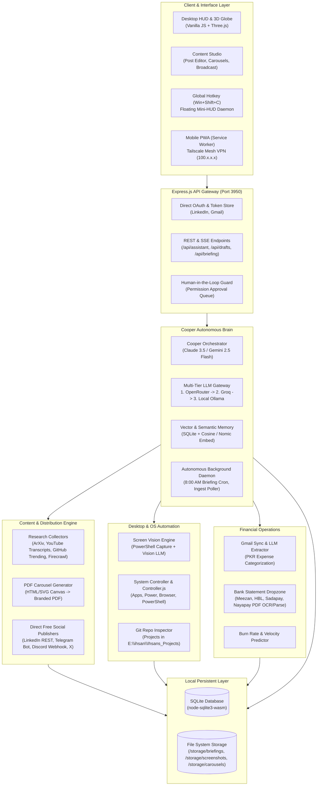
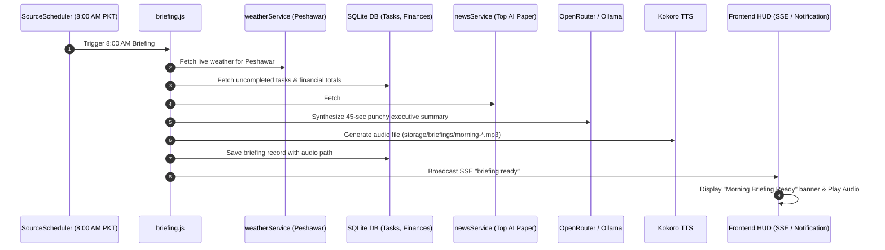
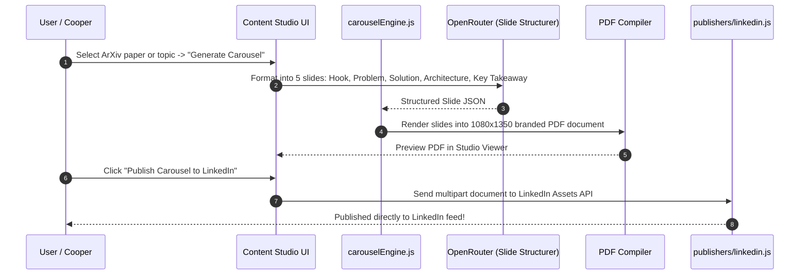
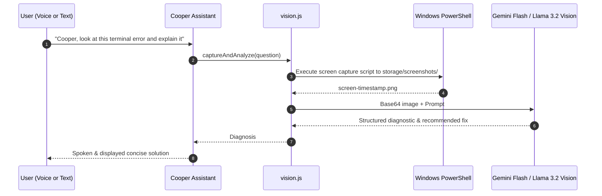

# Agentic OS 2.0 — System Design Architecture & Implementation Roadmap

## 1. Executive Summary & Post-Outage Recovery Audit

Prior to the sudden power outage, significant foundational backend code was written across collectors, publishers, system automation, and intelligence modules. 

### Current Progress Audit: What Survived vs What Remains

| Pillar | Feature | Status in Codebase | Needs Completion |
|---|---|---|---|
| **1. Intel & Autonomy** | Autonomous Morning Briefing (Cron + Voice) | 🟡 **Partial**: `server/ai/briefing.js` & Cooper tool `get_briefing` created; DB table created | Scheduled 8:00 AM PKT cron in `sourceScheduler.js`, HUD "Morning Briefing Ready" banner & auto-play widget |
| | Vector Memory & Personal RAG (SQLite) | 🟢 **Done**: `server/ai/memory.js`, cosine similarity + keyword search fallback, tools `remember` & `recall_memory` wired | Optional UI memory inspector / manager |
| | Local Offline LLM (Ollama Fallback) | 🟢 **Done**: `openrouter.js` handles Ollama / Groq / OpenRouter multi-tier fallback | Settings UI test button for Ollama |
| **2. Content & Social** | Telegram & Discord Free Publishers | 🟡 **Partial**: `server/publishers/telegram.js` & `discord.js` written | Wire into `/api/drafts/:id/schedule` in `index.js`, add UI toggles in Content Studio & Settings |
| | YouTube & ArXiv Collectors | 🟢 **Done**: `server/collectors/arxiv.js`, `github.js`, `youtube.js` implemented and routed in `collectors/index.js` | Test feed runs & Studio UI test |
| | LinkedIn PDF Carousel Generator | 🔴 **Pending**: Not started | Slide generator engine (Hook, Problem, Solution, Architecture, Takeaway), PDF compiler, and LinkedIn document upload |
| **3. Desktop & Vision** | Multimodal Screen Vision ("Look at this") | 🟢 **Done**: `server/ai/vision.js` (PowerShell screen grab + Gemini/Llama Vision), Cooper tool `capture_screen` | HUD quick-action button for screen capture |
| | Local Git Watcher & Project Launcher | 🟢 **Done**: `server/system/projects.js` (`list_projects`, `git_status`, `open_project` tools) | Frontend UI integration |
| | Global System Hotkey & Tray Daemon | 🔴 **Pending**: `ULTRON.bat` exists, but no global hotkey daemon | Global hotkey script (AutoHotkey / Node shortcut) for `Win + Shift + C` summoning floating HUD |
| **4. Financial & Life Ops** | PDF Bank Statement Dropzone | 🔴 **Pending**: Not started | Drag-and-drop zone in Expenses HUD, PDF text parser for Pakistani banks (Meezan, HBL, Nayapay, Sadapay) via LLM |
| | PKR Burn Rate & Anomaly Predictor | 🟡 **Partial**: Cooper `analyze_spending` tool exists | HUD visual indicator for spending velocity & monthly burn rate |
| **5. Mobile Remote Access** | PWA + Tailscale VPN | 🔴 **Pending**: Not started | `manifest.json`, service worker, PWA icons, offline cache, Tailscale remote IP guide |

---

## 2. End-to-End System Design Architecture

---

## 3. Detailed Data & Workflow Flows

### Flow A: Autonomous Morning Briefing (Proactive Push)

### Flow B: LinkedIn PDF Carousel Generation & 1-Click Publishing

### Flow C: Multimodal Screen Vision ("Look at My Screen")

---

## 4. Phased Implementation Roadmap & Todo List

### Phase 1: Complete Social Hubs & Content Engine (P0)
- [ ] **Telegram & Discord Direct Wire-Up**:
  - Connect `publishers/telegram.js` and `publishers/discord.js` to `/api/drafts/:id/schedule` and `/api/publish/now` in `server/index.js`.
  - Add Telegram & Discord channels to Content Studio post publisher modal and Settings account cards.
  - Test publishing text and images to Discord and Telegram.
- [ ] **ArXiv & YouTube Studio Ingestion**:
  - Add quick import buttons in Content Studio ("Import YouTube Transcript", "Import ArXiv Paper").
  - Test scraping top papers from `cs.AI` and auto-generating studio drafts.

### Phase 2: Autonomous Morning Briefing & Proactive HUD (P1)
- [ ] **Briefing Cron Worker**:
  - Register 8:00 AM PKT scheduled job in `sourceScheduler.js`.
  - Create endpoint `GET /api/briefings/latest` and `POST /api/briefings/generate`.
- [ ] **HUD Proactive Banner & Audio Player**:
  - Add floating "Morning Briefing Ready" widget with 1-click listen button to `hud.js` and `index.html`.
  - Add auto-prompt trigger when opening HUD between 8:00 AM and 11:00 AM.

### Phase 3: LinkedIn PDF Carousel Generator (P1)
- [ ] **Carousel Generation Engine (`server/ai/carousel.js`)**:
  - Prompt template that distills technical topics into 5 branded slides: Hook, Core Challenge, Technical Architecture, Benchmarks/Code, Executive Takeaway.
  - Server-side slide renderer to create a multi-page PDF (using pure SVG/PDFKit or headless canvas).
- [ ] **LinkedIn Document Publishing**:
  - Implement LinkedIn `rest/documents` upload protocol in `publishers/linkedin.js`.
  - Add Carousel preview modal in Content Studio with 1-click direct publishing.

### Phase 4: Financial Statement Dropzone & PKR Anomaly Predictor (P2)
- [ ] **PDF Bank Statement Dropzone**:
  - Add drag-and-drop zone in Expenses panel for Meezan, HBL, Nayapay, Sadapay statements.
  - Implement PDF text parsing endpoint (`/api/expenses/upload-statement`) using an LLM to parse tabular rows directly into `insertTransaction()`.
- [ ] **PKR Burn Rate Velocity Predictor**:
  - Add monthly velocity metric (e.g., "% of budget burned in X days") to HUD expenses summary.

### Phase 5: Desktop Hotkey & Mobile PWA Setup (P2)
- [ ] **Global Hotkey & Desktop Tray**:
  - Provide a lightweight AutoHotkey / PowerShell tray launcher mapped to `Win + Shift + C` that summons or focuses the Cooper HUD.
- [ ] **Mobile PWA Setup**:
  - Create `public/manifest.json` and `public/sw.js` (service worker).
  - Add install banner and viewport mobile touch optimizations.
  - Document Tailscale VPN setup for seamless phone-to-PC connection.

---

## 5. Verification & Testing Plan

1. **Telegram/Discord**: Send a test post with image from Content Studio and verify receipt in the target channel/server.
2. **Briefing Cron**: Trigger `/api/briefings/generate` and verify audio generation and playback in the HUD.
3. **LinkedIn Carousel**: Generate a 5-slide PDF for a trending ArXiv paper, verify slide formatting, and test upload.
4. **Bank Dropzone**: Upload a sample Pakistani bank PDF statement and confirm transactions are added to SQLite with correct categories and PKR amounts.
5. **Mobile PWA**: Validate PWA audit in browser DevTools (Lighthouse PWA check) and service worker registration.
