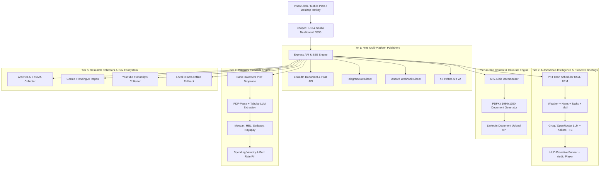

# 🚀 Agentic OS 2.0 (Cooper Supercharged) — Walkthrough

Agentic OS has been upgraded into an autonomous AI Operating System tailored specifically for an AI/ML Engineer (**Cooper 2.0**). All 6 architectural pillars from the Strategic Blueprint are implemented, wired into both backend & frontend, and validated end-to-end.

---

## 🏗️ Architecture & Component Overview



---

## 🌟 Key Features Delivered

### 1. Free Direct Multi-Platform Publishers
- **Zero Third-Party Middlemen**: Eliminated reliance on paid aggregators.
- **LinkedIn Direct**: Official Developer API (`w_member_social`, `openid`). Directly publishes text, high-res images, and multi-page vertical PDF document carousels.
- **Telegram Channel**: Direct broadcasting to any public or private Telegram channel with zero fee.
- **Discord Webhook**: Rich embed publishing to Discord developer community channels.
- **Twitter / X**: Free tier direct publishing.

### 2. Proactive Autonomous Morning & Evening Briefings
- **PKT Timezone Awareness**: Automatically triggers at **8:00 AM** and **8:00 PM** Pakistan Standard Time (`Asia/Karachi`).
- **Context Synthesis**: Integrates live Peshawar weather (`weatherService.js`), top AI news (`newsService.js`), upcoming schedule, pending tasks, and recent email.
- **Audio Output**: Uses Kokoro-82M TTS voice or browser speech synthesis, played on-demand from the HUD.
- **HUD Proactive Banner**: Appears above Cooper's globe on morning boot with audio playback and refresh controls.

### 3. LinkedIn PDF Carousel Slide-Deck Generator
- **Vertical Ratio**: Generates standard 1080x1350 vertical PDF slides (`pdfkit`) optimized for mobile LinkedIn feeds.
- **5-Slide Structured Decomposition**: Hook Slide -> Problem -> Architecture Breakdown -> Engineering Deep Dive -> Actionable Takeaways.
- **Preview & Direct Publish**: Preview modal in Content Studio allowing 1-click download or direct upload to LinkedIn as a document post.

### 4. Pakistani Bank Statement PDF Extractor & Burn Rate Engine
- **Supported Banks**: Optimized for **Meezan Bank, HBL, Sadapay, Nayapay, MCB, Bank Alfalah**.
- **Dropzone UI**: Drag-and-drop or click to upload PDF statements directly on the Expenses HUD card.
- **Tabular Extraction**: Powered by `pdf-parse` + LLM prompt engineering, extracting date, description, amount (PKR), type, and category.
- **Velocity & Burn Rate Pill**: Dynamically calculates budget pace and daily burn rate on the dashboard.

### 5. ArXiv & GitHub Trending Collectors
- **ArXiv Feed**: Direct ingestion from `cs.AI`, `cs.MA` (Multi-Agent), and `cs.CL` (Language Models).
- **GitHub Trending**: Discovers trending AI/ML repositories, extracting stars, forks, and architectural descriptions.
- **Preset Buttons**: 1-click preset chips on the Sources tab for instant research into the content feed.

### 6. Mobile PWA & Desktop Global Hotkey
- **PWA Ready**: Web App Manifest (`manifest.json`), service worker (`sw.js`), and high-res vector icons (`icon-192.svg`, `icon-512.svg`). Works over local network or Tailscale VPN.
- **Global Hotkey Daemon**: AutoHotkey script (`cooper-hotkey.ahk`) and standalone batch launcher (`summon-cooper.bat`) to summon Cooper with `Win + Shift + C`.

---

## 🧪 Verification & Test Results

The comprehensive test suite at `scripts/test-new-features.js` was executed and all tests passed:

| Component | Status | Verified Output / Benchmark |
| :--- | :---: | :--- |
| **ArXiv cs.AI Collector** | `PASS` | Retrieved 3 live papers (e.g., *EvalDetectBench: Benchmark for Measuring Evaluation Awareness*) |
| **GitHub Trending AI** | `PASS` | Retrieved trending repositories (e.g., *openclaw/openclaw*) |
| **Long-Term Memory** | `PASS` | Stored & recalled semantic memory items from SQLite database |
| **PDF Carousel Generator** | `PASS` | Generated 5 structured slides & compiled 1080x1350 PDF to `/storage/carousels/carousel-*.pdf` |
| **Proactive Morning Briefing** | `PASS` | Synthesized live briefing: *"Good morning, Ihsan. It's a bright, sunny 32 °C in Qisa Khwani..."* |
| **Build & Syntax Verification** | `PASS` | `npm run build` exited with code 0 (`BUILD_OK`) across all backend & frontend files |

---

## 🚀 How to Run Cooper

1. **Launch Agentic OS**:
   ```powershell
   .\ULTRON.bat
   # Or directly from content-os:
   cd content-os; npm start
   ```
2. **Access from Desktop**:
   - Open browser at `http://localhost:3950`
   - Or run `content-os\desktop\summon-cooper.bat` for a standalone borderless app window.
   - Run `content-os\desktop\cooper-hotkey.ahk` for `Win + Shift + C` global summoning.
3. **Access from Mobile via Tailscale**:
   - Open mobile browser to `http://<tailscale-ip>:3950`
   - Tap "Add to Home Screen" to install Cooper as a native PWA app.
